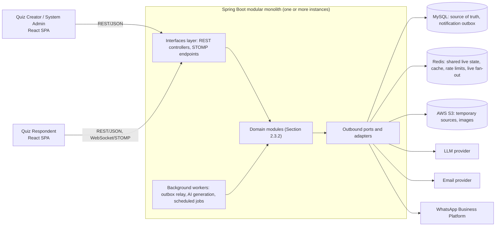

# Software Requirements Specification (SRS)
## Web-Based Quiz Engine Tool (Qwizly)

| Document metadata | Value |
|---|---|
| Author | Zeinab Suliman Mohamed Osman |
| Document version | **1.9** |
| Status | Revised |
| Project type | Portfolio project |
| Date | 14 November 2026 |

---

## 1. Introduction

### 1.1 Purpose

This document specifies the functional and non-functional requirements of the Web-Based Quiz Engine Tool (Qwizly). It describes the system's intended features, behavior, constraints, architecture, and quality attributes.

It is intended for anyone interested in understanding, evaluating, or contributing to the project, including potential users, developers, collaborators, and recruiters reviewing Qwizly as part of a professional portfolio.

### 1.2 Project Description

Qwizly is a lightweight, interactive, web-based quiz engine that enables Quiz Creators to build quizzes from scratch or from ready-to-use templates. Quiz Creators can write questions and answers manually or generate them with AI using their own information sources. They can publish quizzes, distribute access links, and review submitted results. Quiz Respondents participate through a web browser without creating an account.

Qwizly supports self-paced quizzes and host-controlled live quiz sessions.

### 1.3 Vision

To empower educators, trainers, marketers, and community organizers to turn their knowledge and materials into engaging, professionally designed, interactive quizzes, and to reach Quiz Respondents on different devices through a shareable link distributed by email or WhatsApp.

### 1.4 Goals

- **G1:** Allow Quiz Creators to provide information sources (text, documents, and supported links) from which AI generates questions and answers.
- **G2:** Allow Quiz Creators to create quizzes manually or from ready-to-use templates.
- **G3:** Support both self-paced and live quiz modes.
- **G4:** Allow Quiz Creators to distribute published quiz links by email or WhatsApp.
- **G5:** Automatically save attempts, calculate scores, and provide results to Quiz Respondents according to configured release rules.
- **G6:** Provide Quiz Creators with basic statistics and submitted-attempt records.
- **G7:** Enforce ownership and access control. Quiz Creators manage only their own quizzes, while anonymous Quiz Respondents verify a communication channel using a one-time verification code before participating.

### 1.5 Scope

**In scope:**

- Registered Quiz Creator and System Admin accounts.
- Quiz creation, draft editing, templates, preview, publishing, closing, archiving, and permitted duplication.
- Question and answer authoring, question images, ordering, and randomization.
- Uploading or providing information sources for AI question generation.
- AI-generated question review, acceptance, rejection, regeneration, and source references.
- Self-paced and live quiz participation.
- Shareable quiz links and email/WhatsApp distribution.
- Email-default and optional WhatsApp one-time verification.
- Server-enforced availability windows and quiz/question timers.
- Automatic answer saving, attempt resumption, scoring, and result notifications.
- Configurable score release and correct-answer/explanation release.
- Basic results statistics, submitted-attempt lists, and CSV export.
- Role-based access control, administration, audit logging, and service monitoring.
- Cloud deployment using Docker and AWS.

**Out of scope:**

- Advanced assessment analytics such as question difficulty indices, discrimination scores, and trend dashboards.
- Payments and subscriptions.
- A native mobile application.
- SMS delivery.
- Taking quizzes or submitting answers inside WhatsApp. WhatsApp is used only for link distribution, verification codes, and result notifications.
- Proctoring.
- A reusable question bank.

**Basic statistics boundary:** Basic statistics are limited to the number of submitted attempts, average score, highest score, lowest score, pass rate, and a list of submitted attempts. These are the statistics specified in FR-86. More advanced analytics are out of scope.

### 1.6 Definitions and Abbreviations

| Term | Definition |
|---|---|
| **Quiz Creator** | A registered user who creates, edits, publishes, distributes, and manages quizzes. |
| **Quiz Respondent** | An anonymous participant who opens a shareable quiz link, verifies a communication channel, and takes a quiz without registering for an account. |
| **System Admin** | A privileged user who manages system configuration, accounts, moderation, and operational monitoring. |
| **Quiz** | A configured set of questions, answers, settings, release rules, and lifecycle state. |
| **Question** | An individual item presented to a Quiz Respondent. |
| **Option** | A selectable answer associated with a single-choice, multiple-choice, or true/false question. |
| **Attempt** | One Quiz Respondent's individual participation in a quiz. |
| **Answer** | A response submitted or saved for a question within an Attempt. |
| **Template** | A predefined quiz layout, theme, and optional default configuration. |
| **Information Source** | Material supplied by a Quiz Creator for AI question generation. |
| **One-time verification code** | A temporary, single-use code sent to a Quiz Respondent's selected email or WhatsApp channel to verify access. |
| **Self-paced mode** | A mode in which Quiz Respondents complete a quiz independently within its availability window and configured time limit. |
| **Live mode** | A host-controlled mode in which questions are released to participants during a shared live session. |
| **Availability window** | The start and end timestamps during which a published quiz can be accessed. |
| **Score release** | The configured time at which a Quiz Respondent can access their calculated score/result. |
| **Answer and explanation release** | The configured time at which correct answers and their explanations become available to Quiz Respondents. |
| **UTC** | Coordinated Universal Time, used for storing timestamps and evaluating deadlines. |

### 1.7 References

- Qwizly project README: features, technology stack, and high-level architecture.
- WhatsApp Business Platform documentation.
- OWASP Application Security Verification Standard (ASVS).
- Web Content Accessibility Guidelines (WCAG) 2.2.

---

## 2. Overall Description

### 2.1 Domain Problem

Teachers, trainers, community organizers, and event hosts need to assess knowledge or run engaging question sessions. Building quizzes manually can be time-consuming, and distributing them to participants can be inconvenient. Qwizly reduces this effort by providing manual quiz creation, templates, AI-assisted question generation from creator-provided material, shareable links, automatic scoring, and basic results reporting.

### 2.2 Actors

| Actor | Description |
|---|---|
| **Quiz Creator** | Registered user who creates and manages their own quizzes, supplies information sources, uses AI generation, distributes quiz links, and views statistics and submitted attempts for their quizzes. |
| **Quiz Respondent** | Anonymous participant who opens a shareable link, verifies using a one-time verification code, takes a quiz, and accesses their own released result. A Quiz Respondent does not have a registered Qwizly account. |
| **System Admin** | Configures system-wide settings, manages and suspends registered users, configures external integrations, and monitors system health and operational failures. |
| **External services** | LLM provider, email provider, WhatsApp Business Platform, AWS infrastructure and object storage. |

### 2.3 Architecture and module boundaries

Qwizly is a single deployable Spring Boot backend organized as a **modular monolith**, served to a React single-page frontend. The goal is strong, enforceable module boundaries with simple operations. Technology choices are listed in Section 2.4.

#### 2.3.1 Architectural style and key decisions

The architecture follows these principles:

- **Modular monolith.** One deployable Spring Boot application with enforced module boundaries (Section 2.3.2).
- **Server-authoritative behavior.** The server owns timing, validation, scoring, and access decisions (C4). The browser only collects input and renders server-provided state; client countdowns are informational only.
- **Stateless application instances.** Durable state lives in MySQL. Shared, ephemeral state (live-session state, caches, rate-limit counters) lives in Redis, so instances can be added without sticky sessions (NFR-7).
- **External providers behind ports.** The LLM provider, email provider, WhatsApp Business Platform, and object storage are reached through interfaces, so domain logic does not depend on a specific vendor.
- **Cross-cutting concerns implemented once.** Authentication, authorization checks, input validation, the error response format, correlation identifiers, and rate limiting live in shared infrastructure instead of being repeated in each module (NFR-3, NFR-13).

The decisions below record the rationale and the trade-off accepted for each.

| Decision | Rationale | Trade-off |
|---|---|---|
| Modular monolith with enforced boundaries rather than microservices | Attempt submission, scoring, and the creation of result notifications stay consistent in one database transaction (NFR-9). No distributed-transaction complexity; simple deployment and debugging that fits the Docker Compose workflow (NFR-11). | One scaling unit. Boundaries must be protected by automated architecture tests (for example ArchUnit or Spring Modulith verification) so they do not erode. This also keeps later extraction possible. |
| MySQL as source of truth, Redis for ephemeral state | Durable attempts and scores (BR-23). Fast shared state for live mode, such as presence, leaderboard sorted sets, and rate-limit counters. | An extra component. Losing Redis must never lose business data, so the live-session status and current question are also checkpointed in MySQL and can rebuild live state after a Redis restart. |
| Cross-instance live-mode broadcasting through Redis Pub/Sub fan-out (default), or an external STOMP broker relay such as RabbitMQ | Spring's built-in simple STOMP broker is in memory on each instance, so a message published on one instance would not reach respondents connected to another. Fan-out lets any instance serve any participant (FR-49). | Pub/Sub does not guarantee delivery, so reconnecting clients must be sent the current state (FR-50, FR-93). The load balancer must support WebSocket upgrades and long-lived connections. A broker relay gives stronger delivery guarantees at the cost of another component; the choice is confirmed by load tests (Section 11). |
| Transactional outbox for notifications | Notification jobs are written in the same transaction as the change that triggers them, and a relay sends them with bounded retries (FR-102). Redis is never the only record of a pending notification. | Needs a relay process that is safe to run on several instances (for example by claiming rows with row-level locks). Delivery is at-least-once, so provider calls and consumers must be idempotent. |
| Scheduled background work protected by a distributed lock | Auto-submission when time limits expire (FR-44), closing quizzes at their availability end (Section 5.2), scheduled result releases (FR-31), and temporary-source cleanup (FR-82) must run once across all instances. Deadlines are also checked at request time, so correctness never depends on scheduler timing. | Needs a lock mechanism (for example ShedLock backed by MySQL or Redis). Jobs must be idempotent and monitored (NFR-13). |
| Asynchronous AI generation | Each request becomes a GenerationJob processed by background workers with timeouts, bounded concurrency, and per-creator quotas (FR-27, FR-28). LLM latency never blocks request threads, and output is validated against a structured schema before draft questions are saved (FR-80). | Job state, retries, and partial failures must be modeled explicitly. Source text is untrusted input to the LLM (R2, R9). |
| Server-authoritative time and scoring | Integrity of timing and results (C4). Deadlines are stored in UTC and evaluated against server time. | Client countdowns are informational only. Instance clocks must be synchronized (for example with NTP or the AWS time sync service). |
| Idempotent submission plus database constraints | Safe retries and no attempt-limit violations under concurrency (R6): a unique idempotency key per submission and a unique constraint on quiz, respondent, and attempt number. | Extra key handling and constraint design. |
| Token-based sessions with revocation | Short-lived signed access tokens with server-side refresh tokens (FR-5), so logout and account suspension (FR-66) take effect. Respondent sessions are short-lived and scoped to one quiz (FR-65). | Access tokens stay valid until they expire unless a denylist is checked, so lifetimes must be short. Refresh tokens need storage and cleanup. |
| Ports and adapters for external providers | Provider changes and testing with test doubles do not affect domain logic. | Additional indirection. |



#### 2.3.2 Module responsibilities and data ownership

Each module is a bounded context that owns the aggregates listed below; the aggregate root is shown in bold. Entity names refer to Section 5.3. Dependencies listed are synchronous calls to the other module's public contract. Modules also react to integration events published through their contract (for example, Distribution and share links creates a share link when Quiz management publishes a quiz); event subscriptions do not create dependencies.

| Module | Responsibilities | Owned aggregates | Depends on |
|---|---|---|---|
| Accounts and authorization | Registration, authentication, roles, token sessions, password reset, suspension and reinstatement | **User** (includes RefreshToken) | None |
| Quiz management | Quiz settings, templates, lifecycle transitions, publishing validation, duplication, preview, question types, options, accepted text answers, scoring configuration, authoring rules | **Quiz** (includes Question, Option, AcceptedTextAnswer), **Template** | Accounts and authorization |
| Source processing and AI generation | Source upload and validation, text extraction, asynchronous LLM generation, source references, generation quotas, temporary file cleanup | **GenerationJob** (includes SourceReference) | Quiz management |
| Distribution and share links | Link generation, disabling, expiry and use limits | **ShareLink** | Quiz management |
| Respondent verification | One-time code issuing and validation, rate limiting, quiz-scoped respondent sessions | **QuizRespondent**, **OneTimeVerificationCode** | Distribution and share links |
| Attempts and scoring | Attempt start, autosave, resumption, idempotent submission, attempt limits, server-side timing and scoring | **Attempt** (includes Answer, AnswerOptionSelection) | Quiz management, Respondent verification |
| Live sessions | Session lifecycle, lobby, host-controlled question release, real-time broadcast, reconnection, host connection state | **LiveSession** | Attempts and scoring, Quiz management, Respondent verification |
| Results and notifications | Release schedules, basic statistics and CSV export (read models over submitted attempts), notification outbox, retries, delivery through email and WhatsApp | **NotificationJob** | Attempts and scoring, Quiz management |
| Administration and audit | System settings, user administration, audit log, operational failure visibility | **AuditLog** | Accounts and authorization |

The Quiz aggregate contains its questions, options, and accepted text answers, so publishing validation and the rules that every question needs question text, answer options, and a correct answer (FR-70, FR-72 to FR-74) are enforced in one place. Aggregates in other modules refer to a Quiz or Question by identifier only.

#### 2.3.3 Internal module structure

Each module is a bounded context and follows the same Domain-Driven Design (DDD) layering. The interfaces layer calls the application layer, which orchestrates the domain layer. The domain layer depends on no other layer. The infrastructure layer implements the repository interfaces and ports that the domain and application layers define (dependency inversion).

```
<module>/
  contract/        published language: public facade interfaces, DTOs, and integration events that other modules may use
  interfaces/      inbound adapters: REST controllers, STOMP handlers, request and response mapping
  application/     application services (use cases), commands and queries, transaction boundaries, domain-event handlers
  domain/
    model/         aggregates (with their roots), entities, value objects
    service/       domain services
    event/         domain events
    repository/    repository interfaces, one per aggregate root
  infrastructure/  outbound adapters: repository implementations, provider adapters (LLM, email, WhatsApp, object storage)
```


### 2.4 Technology and deployment environment

Qwizly is a web application accessed through modern desktop and mobile browsers. It uses the following technologies:

- **Frontend:** React, HTML, CSS, and Bootstrap.
- **Backend:** Java and Spring Boot, implemented as a modular monolith.
- **Backend modules:** nine modules with defined responsibilities, aggregate ownership, and dependency rules, described in Section 2.3.
- **Security:** Spring Security with signed, short-lived access tokens and server-side refresh tokens. One-time verification codes and share-link tokens are stored only as hashes.
- **Database:** MySQL, with schema changes managed through versioned migrations.
- **Shared runtime state:** Redis for live-session state, cache, rate-limit counters, and live-mode message fan-out across backend instances.
- **Real-time communication:** WebSocket/STOMP for live mode.
- **Background processing:** A durable job/outbox mechanism for result notifications and retryable external-provider operations, plus scheduled jobs protected by a distributed lock so they run once across instances. Redis shall not be the only record of a pending notification.
- **Object storage:** AWS S3 for temporary source processing and question images, with lifecycle rules for temporary source deletion.
- **Observability:** Structured logs with correlation identifiers, health checks, and operational metrics (NFR-13).
- **Local deployment:** Docker and Docker Compose.
- **Production target:** AWS containers, managed MySQL, Redis, object storage, and email delivery service.

**Scaling note:** The 1,000-simultaneous-respondent target may require at least two backend instances behind a load balancer. WebSocket session routing, shared live state, and message broadcasting must work across instances (Section 2.3.1), and the load balancer must support WebSocket upgrades. The target must be validated through load tests; the architecture alone does not prove capacity.

### 2.5 Constraints

- **C1:** WhatsApp delivery is subject to WhatsApp Business Platform policies, templates, recipient consent, availability, and rate limits.
- **C2:** AI generation depends on a third-party LLM API and is subject to its cost, latency, availability, and quotas.
- **C3:** Email delivery depends on the configured email provider.
- **C4:** The server shall act as the authoritative source to determine and enforce deadlines, calculate scores, manage attempt states, and control access. The browser shall be restricted to collecting user input and rendering server-provided state and shall not make binding decisions regarding validation, timing, or scoring.
- **C5:** Uploaded source files are temporary inputs for AI generation and are not retained after generation completes.

### 2.6 Assumptions and Dependencies

- **A1:** Users have a supported modern browser and internet access.
- **A2:** Quiz Creators have the right to use the information sources they provide.
- **A3:** Quiz Respondents can access the email address or WhatsApp number they use for verification.
- **A4:** Email delivery is configured. WhatsApp delivery is optional and requires an approved WhatsApp Business integration.
- **A5:** An LLM API key and an appropriate usage budget are available.
- **A6:** The initial capacity target is up to 1,000 simultaneous Quiz Respondents in one live session, subject to load testing.
- **A7:** The system uses UTC for stored timestamps and deadline evaluation; the client displays dates and times in the user's local timezone.

---

## 3. Functional Requirements

Priority definitions: **M** = Must have, **S** = Should have, **C** = Could have.

### 3.1 Accounts, Roles, and Access

| ID | Requirement | Priority |
|---|---|---|
| FR-1 | The system shall allow Quiz Creators and System Admins to register and authenticate using email and password. | M |
| FR-2 | The system shall support the roles Quiz Creator and System Admin for registered accounts and shall enforce authorization on every protected endpoint. Quiz Respondents shall use a separate, limited verification-based session. | M |
| FR-3 | A Quiz Creator shall be able to access, modify, and delete only quizzes they own, subject to administrative moderation. | M |
| FR-4 | A Quiz Respondent shall be able to access a quiz through a valid shareable link after verifying using a one-time verification code, and shall be able to access only their own attempts and released results. | M |
| FR-5 | The system shall support token-based authenticated sessions for registered users, including refresh and logout. | S |
| FR-6 | The system shall support password reset by email. | S |
| FR-7 | The system could support social login using Google. | C |
| FR-8 | A System Admin shall be able to suspend and reinstate a Quiz Creator account without deleting the account's quizzes, attempts, results, or other retained data. | S |
| FR-9 | A suspended Quiz Creator shall not be able to authenticate or perform creator actions. | S |

### 3.2 Quiz Creation and Management

| ID | Requirement | Priority |
|---|---|---|
| FR-10 | A Quiz Creator shall be able to create a quiz with a title, description, mode, and configurable settings. | M |
| FR-11 | A Quiz Creator shall be able to edit a Draft quiz, including adding, modifying, reordering, and deleting questions. | M |
| FR-12 | A Quiz Creator shall be able to create a quiz from a ready-to-use template. | M |
| FR-13 | A quiz shall follow the lifecycle Draft → Published → Closed → Archived. | M |
| FR-14 | A Quiz Creator shall be able to close a Published quiz that they own, after which it shall accept no new attempts. | M |
| FR-15 | A Quiz Creator shall be able to archive a Closed quiz that they own. | M |
| FR-16 | Only Published quizzes within their availability window shall accept new attempts. | M |
| FR-17 | A Published quiz shall not be editable. | M |
| FR-18 | A Quiz Creator may duplicate a Published or Closed quiz into a new Draft. | M |
| FR-19 | An Archived quiz shall not be eligible for duplication. | M |
| FR-20 | A Quiz Creator shall be able to delete a quiz after confirmation. Deletion shall follow the data-handling rule in BR-10. | M |
| FR-21 | A Quiz Creator shall be able to preview a quiz in a view similar to the Quiz Respondent experience. | S |
| FR-22 | The system shall allow a Draft quiz to be saved while it is being configured, but shall prevent publication until all system-controlled publishing validations have passed. | M |
| FR-23 | Before publication, the system shall validate whether the quiz is structurally complete and technically configurable. | M |
| FR-24 | Publishing validation includes checking the quiz title, at least one question, required answer options or accepted text answers, at least one correct answer where automatic scoring applies, valid points, valid timing settings, and valid release settings. | M |
| FR-25 | Publishing validation shall not attempt to judge the educational quality, factual correctness, ambiguity, age-appropriateness, grammar, clarity, fairness, pedagogical soundness, or wording quality of question content. Those content decisions remain solely the Quiz Creator's responsibility. | M |

### 3.3 Questions and Answers

| ID | Requirement | Priority |
|---|---|---|
| FR-26 | The system shall support single-choice, multiple-choice, and true/false questions. | M |
| FR-27 | The system shall support short-text answers using normalized matching. Normalization shall ignore capitalization, surrounding or repeated whitespace, and punctuation. | S |
| FR-28 | The Quiz Creator shall be responsible for accounting for acceptable spelling and accent/diacritic variations, including by defining accepted answer variants where supported. | S |
| FR-29 | For each question, the Quiz Creator shall specify its points, correct answer or accepted answer(s), and optional explanation. | M |
| FR-30 | A Quiz Creator shall be able to add optional hints to questions. | S |
| FR-31 | A Quiz Creator shall be able to attach an image to a question. | C |
| FR-32 | The system shall allow the Quiz Creator to configure question-order and answer-option randomization for each quiz. | S |
| FR-33 | The system shall require each question to contain non-empty question text before the quiz can be published. | M |
| FR-34 | For single-choice, multiple-choice, and true/false questions, the system shall require the necessary answer options and at least one option marked as correct before publication. | M |
| FR-35 | For short-text questions that are automatically scored, the system shall require at least one accepted correct answer before publication. | M |
| FR-36 | The system shall allow the Quiz Creator to configure how unanswered questions are scored. The default rule shall award zero points for an unanswered question. | M |
| FR-37 | The system shall support a configurable multiple-choice scoring policy, with all-or-nothing scoring as the default. | S |

### 3.4 Information Sources and AI Generation

| ID | Requirement | Priority |
|---|---|---|
| FR-38 | A Quiz Creator shall be able to provide information sources by uploading supported PDF, DOCX, or TXT files, pasting text, or supplying supported links. | M |
| FR-39 | The system shall validate uploaded files by supported type and configured size limits and reject invalid or unsafe files. | M |
| FR-40 | A Quiz Creator shall be able to request AI generation of questions and answers from selected sources and specify the number of questions, question types, and difficulty. | M |
| FR-41 | Generated questions shall be saved as drafts that the creator can review, edit, accept, or reject before they enter the quiz. | M |
| FR-42 | AI generation shall run asynchronously, showing progress and a clear error if it fails or times out. | S |
| FR-43 | The system shall limit AI generation per Quiz Creator to control cost. | S |
| FR-44 | The system shall assess whether the supplied source material contains sufficient information for the requested generation. If it is insufficient, the system shall display a clear message and request additional supported resources or replacement of the current source. | M |
| FR-45 | The system shall generate questions and answers related to and supported by the supplied source material and shall not intentionally introduce unsupported facts. | M |
| FR-46 | The system shall display source references alongside AI-generated questions so that the Quiz Creator can review the supporting source or passage. | M |
| FR-47 | If generation fails or only partially succeeds, the system shall display an error and shall not present an incomplete question set as a successful generation result. | M |
| FR-48 | The system shall allow a Quiz Creator to regenerate questions they have rejected. | S |
| FR-49 | The system shall delete uploaded source files and temporary extracted source content after the generation job has completed, whether successfully or unsuccessfully. Temporary files left by interrupted jobs shall be cleaned up within 24 hours. | M |

### 3.5 Quiz Configuration and Modes

| ID | Requirement | Priority |
|---|---|---|
| FR-50 | A Quiz Creator shall be able to select one mode for each quiz: self-paced or live. | M |
| FR-51 | A Quiz Creator shall be able to configure the quiz availability start and end timestamps, an attempt limit, and a time-limit strategy. The time-limit strategy shall be either one duration for the entire attempt or a separate duration for each question. | M |
| FR-52 | A Quiz Creator shall be able to configure the score-release schedule separately from the correct-answer and explanation-release schedule. Each schedule shall support release immediately after submission, when the quiz availability end time is reached, or at a specified future date and time. | M |
| FR-53 | A Quiz Creator shall be able to configure a passing score. | S |
| FR-54 | A Quiz Creator shall be able to apply a visual theme from the available templates. | S |
| FR-55 | When a whole-quiz duration is configured, the Quiz Respondent shall be able to allocate the available time among the quiz questions by themselves. | M |
| FR-56 | When per-question durations are configured, the system shall enforce the configured duration for each question using server-authoritative timestamps. | M |
| FR-57 | The system shall enforce quiz availability start and end timestamps on the server. Client-side clocks and countdowns shall be informational only. | M |
| FR-58 | When a Quiz Respondent opens a quiz before its availability start time, the system shall display a message that the quiz is not yet available and show the exact scheduled opening date and time in the respondent's local timezone. | M |
| FR-59 | The system shall reject invalid time configurations, including an end timestamp that is not later than the start timestamp and non-positive duration values. | M |

### 3.6 Distribution and Access Granting

| ID | Requirement | Priority |
|---|---|---|
| FR-60 | The system shall generate a unique, unguessable shareable link for each published quiz. | M |
| FR-61 | The system could support restricting a quiz to invited respondents identified by email address or WhatsApp number in a future version. The initial release shall use an open shareable link protected by one-time verification. | C |
| FR-62 | A Quiz Creator shall be able to disable a quiz's shareable link so that no new Quiz Respondent can start an attempt through it. | M |
| FR-63 | A Quiz Creator shall be able to distribute a published quiz link through WhatsApp to a group of contacts, subject to WhatsApp Business Platform requirements. The quiz itself shall always be taken in the web application. | S |
| FR-64 | A quiz link shall support an optional expiry date and maximum number of uses. | S |
| FR-65 | The system shall allow Quiz Creators to distribute published quiz links to Quiz Respondents through email. | M |

### 3.7 Taking a Quiz (Self-Paced Mode)

| ID | Requirement | Priority |
|---|---|---|
| FR-66 | The system shall render questions according to the quiz configuration, including question order, randomization, and display preferences. | M |
| FR-67 | The system shall automatically save changed answers to persistent storage no later than one second after an answer change under normal network conditions. It shall allow an unfinished attempt to be resumed after the Quiz Respondent verifies the same communication channel. | M |
| FR-68 | The system shall enforce attempt limits using concurrency-safe processing. | M |
| FR-69 | The system shall automatically submit an attempt when its configured server-side time limit expires, using the answers successfully saved by that time. | M |
| FR-70 | If a network disconnection occurs during an attempt and the quiz remains Published and the attempt remains within its permitted time window, the Quiz Respondent shall be able to resume from the latest answers saved by the server. | M |
| FR-71 | If a Quiz Respondent reconnects after the quiz is Closed, the system shall not allow the respondent to resume the attempt and shall display a message advising them to contact the Quiz Creator. | M |
| FR-72 | The system shall use an idempotent submission mechanism so that retrying a submission after a timeout or uncertain network response does not create duplicate attempts, answers, scores, or notifications. | M |
| FR-73 | The system shall not expose incomplete, unsubmitted attempts to Quiz Creators. Only submitted attempts shall appear in the creator's dashboard. | M |

### 3.8 Live Mode

| ID | Requirement | Priority |
|---|---|---|
| FR-74 | A Quiz Creator acting as host shall be able to start a live session and provide a join code or link. | M |
| FR-75 | Quiz Respondents shall be able to join a live-session lobby, and the host shall be able to see the participants who have joined. | M |
| FR-76 | The host shall control question release. | M |
| FR-77 | Connected Quiz Respondents shall receive each released question through real-time communication, with server-enforced timing. | M |
| FR-78 | The system shall show live results after quiz submission, including a leaderboard when enabled for the quiz. | S |
| FR-79 | The system shall support at least 1,000 simultaneous Quiz Respondents in one live session, subject to the performance targets in NFR-6 and NFR-9. | M |
| FR-80 | A Quiz Respondent who disconnects shall be able to reconnect and continue from the current live-session state, subject to session and quiz rules. | S |
| FR-81 | The system shall allow a Quiz Respondent to join a live session after it has started, subject to the session's access and attempt rules. A late-joining respondent shall be shown the current question or current session state. | M |
| FR-82 | The system shall detect host connection-state changes and notify connected Quiz Respondents whenever the host disconnects or reconnects during the live session. | M |
| FR-83 | The system shall preserve the live-session state during a host disconnection. It shall not silently represent the host as connected while disconnected. The handling of question advancement during a host disconnection shall follow the server-enforced session timing and host-control rules. | M |

### 3.9 Scoring and Results

| ID | Requirement | Priority |
|---|---|---|
| FR-84 | The system shall calculate each submitted attempt's score on the server and make the score available according to the configured score-release schedule. | M |
| FR-85 | The system shall store each attempt with its Quiz Respondent reference, answers, status, score, start timestamp, and submission timestamp. | M |
| FR-86 | A Quiz Creator shall be able to view a basic results summary for each owned quiz, including the number of submitted attempts, average score, highest score, lowest score, pass rate, and a list of submitted attempts. | M |
| FR-87 | A Quiz Creator shall be able to export submitted results as CSV. | S |
| FR-88 | The system shall send a notification containing a link to a Quiz Respondent's result through the email or WhatsApp channel selected by that respondent, according to the configured score-release schedule. | S |
| FR-89 | If the selected release option is scheduled for a later time, the results, correct answers, and explanations shall remain stored and shall be released when they become eligible. | M |
| FR-90 | The system shall not expose correct answers or explanations to a Quiz Respondent before the configured answer-and-explanation release time. | M |
| FR-91 | The system shall calculate basic statistics using submitted attempts only. Incomplete and unsubmitted attempts shall be excluded from attempt counts, averages, highest/lowest scores, and pass-rate calculations. | M |

### 3.10 Administration and Notifications

| ID | Requirement | Priority |
|---|---|---|
| FR-92 | A System Admin shall be able to configure system-wide settings, including default language, external service credentials, and configurable usage limits. Timestamps shall remain stored in UTC. | M |
| FR-93 | A System Admin shall be able to list and delete registered users, subject to authorization rules. | S |
| FR-94 | The system shall record an audit log of security-relevant actions, including authentication events, access grants, account suspension, and deletion actions. | S |
| FR-95 | The system shall retry transient email, WhatsApp, and background-processing failures according to a bounded retry policy. | M |
| FR-96 | When a submission-processing or notification-delivery operation repeatedly fails after the configured retry limit, the system shall record the failure with diagnostic context and a correlation identifier. | M |
| FR-97 | After repeated failures reach the configured retry limit, the system shall notify the System Admin through the configured operational notification channel. | M |

### 3.11 Quiz Respondent Verification (One-Time Verification Code)

| ID | Requirement | Priority |
|---|---|---|
| FR-98 | A Quiz Respondent shall not need a registered account. To access a quiz through its shareable link, the respondent shall provide an email address or, when WhatsApp verification is enabled, a WhatsApp number. | M |
| FR-99 | The system shall send a six-digit one-time verification code to the supplied email address by default. | M |
| FR-100 | The system shall support sending the one-time verification code to the supplied WhatsApp number when WhatsApp verification is enabled by the System Admin. SMS shall not be supported. | S |
| FR-101 | A one-time verification code shall expire after five minutes, be usable once, be stored only as a secure hash, and be invalidated when a replacement code is issued. | M |
| FR-102 | Verification attempts and code requests shall be rate-limited. The initial proposed limit is three code requests per 15 minutes per contact and per IP address, and five incorrect code entries per code. | M |
| FR-103 | After successful verification, the system shall issue a short-lived session scoped to the relevant quiz. Attempt limits shall be counted using the verified respondent contact identity for that quiz. | M |
| FR-104 | A Quiz Respondent shall be able to switch between email and WhatsApp when requesting a new one-time verification code. The newly requested code shall be sent through the newly selected channel, and the previously issued code shall be invalidated. | S |
| FR-105 | A Quiz Respondent who resumes an unfinished attempt on another device shall verify using the same contact identity associated with that attempt. | M |

---

## 4. Non-Functional Requirements

| ID | Category | Requirement |
|---|---|---|
| NFR-1 | Usability | A first-time Quiz Creator shall be able to create a basic quiz from a template in under five minutes without formal training. Common respondent tasks, including opening a link, verifying, answering, and viewing a released result, shall be understandable without specialist knowledge. |
| NFR-2 | Accessibility | The user interface shall target WCAG 2.2 Level AA conformance. At minimum, core workflows shall support keyboard navigation, visible focus, accessible form labels, sufficient text contrast, and meaningful error identification. |
| NFR-3 | Security | All network traffic shall use HTTPS. Registered-user passwords shall be stored using a strong adaptive password hash such as Argon2id or bcrypt. The application shall apply secure session handling, input validation, authorization checks, rate limiting, and protections against relevant OWASP Top 10 risks. One-time verification codes shall be stored only as hashes. |
| NFR-4 | Privacy | Quiz Creators shall access only their own management data and quiz results, subject to System Admin privileges. Quiz Respondents shall access only their own attempts and released results. Contact information shall be collected only as needed for verification and result delivery. |
| NFR-5 | Responsive design | Core workflows shall work on supported desktop and mobile browsers without requiring a native mobile application. |
| NFR-6 | Performance | Under the expected load defined in A6, 95% of ordinary API requests shall complete within two seconds and 95% of typical page loads shall become usable within three seconds, excluding external-provider processing and large file uploads. Performance shall be verified through repeatable tests. |
| NFR-7 | Scalability | The backend shall be stateless where practical and support horizontal scaling. Shared live-session state, coordination, and cache data shall be externalized from individual application instances. MySQL shall remain the persistent source of truth for business records. |
| NFR-8 | Availability | The system shall be designed for 24-hour, 7-day online access, with a target monthly availability of 99.5%, excluding announced scheduled maintenance. This is a project target, not a contractual service-level guarantee. |
| NFR-9 | Reliability and integrity | The system shall support up to 1,000 simultaneous Quiz Respondents in one live session, subject to load-test verification. Submitted answers shall not be lost or counted more than once. Score calculation shall be server-side. Under normal operating conditions, 95% of submitted attempts shall have their score calculated and persisted within two seconds. Eligible result notifications shall be queued within five seconds for 95% of submissions, and handed to the configured delivery provider within 30 seconds for 95% of notifications. External-provider delivery time is outside the system's direct control. |
| NFR-10 | Maintainability | The backend shall be implemented as a modular monolith with clearly separated modules. The project shall include automated tests, OpenAPI documentation, CI checks, and versioned database migrations. |
| NFR-11 | Deployment | The system shall run in Docker containers and support a Docker Compose setup for local development. The target production environment is AWS. |
| NFR-12 | Localization and time | All timestamps shall be stored and evaluated in UTC. The client shall convert timestamps to the user's local timezone for display. The interface should support multiple languages, including right-to-left layouts. |
| NFR-13 | Observability | The system shall provide structured application logs, error logs, health checks, basic operational metrics, and correlation identifiers for failed requests and background jobs. Sensitive values, passwords, one-time verification codes, and full authentication tokens shall not be written to logs. |
| NFR-14 | Cost control | AI and WhatsApp usage shall be metered and subject to configurable quotas or rate limits. |
| NFR-15 | Maintenance | Planned maintenance shall be announced in advance where practicable and scheduled during periods of low expected usage. Maintenance events and service interruptions shall be documented. The project does not promise 24/7 human support. |

---

## 5. Data and Business Rules

### 5.1 Key Business Rules

| ID | Rule |
|---|---|
| BR-1 | Each quiz belongs to exactly one Quiz Creator. Only that creator and authorized System Admins may manage it. |
| BR-2 | A Quiz Respondent may start an attempt only through a valid shareable link, after successful one-time verification, while the quiz is Published and within its availability window. |
| BR-3 | Attempt timing, answer acceptance, and scoring shall be enforced by the server. Client-side values shall not be trusted. |
| BR-4 | A Quiz Respondent shall not exceed the configured attempt limit. |
| BR-5 | A submitted attempt shall be immutable. |
| BR-6 | Correct answers and explanations shall not be sent to the respondent's browser before their configured release time. |
| BR-7 | AI-generated questions shall remain drafts until reviewed and accepted by the Quiz Creator. |
| BR-8 | The score shall be calculated from the points awarded for each question according to the configured scoring policy. |
| BR-9 | Multiple-choice questions shall use all-or-nothing scoring by default. |
| BR-10 | Deleting a quiz shall use soft deletion or an equivalent recoverable data-handling process. |
| BR-11 | All timestamps shall be stored in UTC. The client shall convert timestamps for display. |
| BR-12 | Uploaded source files and extracted source content shall be private and used only for the requested AI generation process. |
| BR-13 | Uploaded source files shall be deleted after that process completes. |
| BR-14 | A Published quiz shall not be edited. A Quiz Creator may duplicate a Published or Closed quiz into a new Draft. An Archived quiz shall not be duplicated. |
| BR-15 | A Draft may be incomplete, but it cannot be Published until all system-controlled publishing validations pass. |
| BR-16 | At least one question is required for quiz publication. Each question must have the adequate data including options, correct answer, and score required by its type and scoring mode. |
| BR-17 | The Quiz Creator is responsible for the wording, clarity, correctness, and suitability of manually authored question content. The system validates structure, not content quality. |
| BR-18 | An unfinished, unsubmitted attempt is not visible to the Quiz Creator. Creator-facing statistics and attempt lists include submitted attempts only. |
| BR-19 | A Quiz Respondent's attempt is associated with their verified contact identity and can be resumed on another device after re-verification, if the quiz and attempt remain eligible. |
| BR-20 | A submission request shall be idempotent. Repeating the same logical submission shall not create duplicate records or duplicate result notifications. |
| BR-21 | Score release is configured separately from correct-answer and explanation release. Correct answers and explanations are released together. |
| BR-22 | An unanswered question is scored according to the Quiz Creator's configured rule; zero points is the default. |
| BR-23 | Redis may hold shared live-session state and cache data, but MySQL remains the source of truth for attempts, answers, scores, and durable business records. |
| BR-24 | A suspended Quiz Creator cannot authenticate or perform creator actions. Suspension does not delete the creator's retained data. |

### 5.2 Quiz Lifecycle

| State | Description | Permitted next state |
|---|---|---|
| Draft | Quiz is being created or edited. It is not available to respondents. | Published |
| Published | Quiz is published. Access is controlled by the availability window and share-link settings. | Closed |
| Closed | No new attempts may be started or resumed. Submitted results remain available according to release rules. | Archived |
| Archived | Quiz is retained for historical reference. It cannot be reopened, republished or duplicated. | None |

A quiz may be closed when its configured availability end time is reached or when the Quiz Creator closes it. The system shall enforce the transition on the server. A Closed quiz may be archived by its Quiz Creator.

### 5.3 Data Entities

| Entity | Key attributes | Relationships |
|---|---|---|
| User | id, name, email, password_hash, role, locale, status, created_at | Owns Quizzes; may be suspended by an Admin |
| RefreshToken | id, user_id, token_hash, expires_at, revoked_at | Belongs to a User; stored so logout and suspension can revoke sessions |
| QuizRespondent | id, verified_contact, contact_type, verified_at, created_at | Has Attempts; receives OneTimeVerificationCodes |
| Template | id, name, theme, default_settings | Used to create Quizzes |
| Quiz | id, owner_id, title, description, mode, status, availability_start_utc, availability_end_utc, timing_strategy, attempt_limit, passing_score, release_settings | Has Questions, ShareLinks, Attempts, and optional GenerationJobs |
| Question | id, quiz_id, type, text, points, hint, explanation, position, unanswered_scoring_rule | Has Options and accepted text answers |
| Option | id, question_id, text, is_correct, position | Belongs to a Question |
| AcceptedTextAnswer | id, question_id, normalized_value or protected answer value | Belongs to a short-text Question |
| SourceReference | id, generation_job_id, source_label, page_or_location, supporting_excerpt_or_reference | Supports a generated question; does not require retaining the uploaded source file |
| GenerationJob | id, quiz_id, parameters, status, error_code, created_at, completed_at | Produces draft Questions and SourceReferences |
| ShareLink | id, quiz_id, token_hash, expires_at, max_uses, uses_count, revoked_at | Grants access to a Quiz |
| Attempt | id, quiz_id, quiz_respondent_id, attempt_number, status, started_at, submitted_at, score, idempotency_key (unique) | Has Answers |
| Answer | id, attempt_id, question_id, text_value, is_correct, points_awarded, saved_at | Belongs to an Attempt and Question; references selected Options where applicable |
| AnswerOptionSelection | answer_id, option_id | Resolves selected options for multiple-choice answers |
| LiveSession | id, quiz_id, host_user_id, join_code_hash, status, current_question_id, host_connection_state | Has participating Attempts |
| OneTimeVerificationCode | id, respondent_contact, channel, code_hash, expires_at, failed_attempts, status | Verifies a Quiz Respondent |
| NotificationJob | id, recipient, channel, notification_type, scheduled_at, status, attempts, last_error | Delivers quiz links, verification codes, or result links |
| AuditLog | id, actor_id, action, target_type, target_id, timestamp, correlation_id | Records security-relevant actions |

**Integrity constraints:**

- A Question must belong to exactly one Quiz.
- An Option must belong to exactly one Question.
- An Answer must belong to exactly one Attempt and one Question.
- Selected options must belong to the question being answered.
- A unique constraint on the combination of Quiz, Quiz Respondent, and attempt number, or an equivalent concurrency-safe mechanism, shall prevent a Quiz Respondent from exceeding the configured attempt limit for a Quiz.
- Submission idempotency shall prevent repeated requests from creating duplicate submissions.

---

## 6. External Interface Requirements

### 6.1 User Interface

The responsive React interface shall provide pages or views for:

- Registration, login, password reset, and account management.
- Quiz Creator dashboard and quiz management.
- Quiz builder, question editor, templates, and preview.
- Information-source upload, AI generation progress, generated-question review, and source references.
- Quiz distribution and share-link management.
- Quiz Respondent verification and quiz-taking.
- Attempt resumption and result viewing.
- Live-session host and participant experiences.
- Basic statistics and submitted-attempt results.
- System Admin account management, configuration, audit records, and operational failure visibility.

The interface shall display clear validation and error messages. Quiz availability timestamps shall be displayed in the user's local timezone.

### 6.2 Software Interfaces

| Interface | Purpose |
|---|---|
| REST API (JSON, versioned and documented with OpenAPI) | Frontend/backend communication and ordinary application operations |
| WebSocket (STOMP) | Live-session events, question release, participant updates, and host connection-state notifications |
| LLM provider API | AI question generation from creator-supplied source content |
| Email provider (SMTP or AWS SES) | Verification codes, quiz links, password reset, result notifications, and operational notifications |
| WhatsApp Business Platform API | Optional verification codes, quiz links, and result links |
| MySQL | Persistent business data and source of truth |
| Redis | Shared live-session state, caching, and coordination |
| Object storage (AWS S3) | Temporary source processing and retained quiz images |


---

## 7. Error Handling

| Situation | Expected behavior |
|---|---|
| Invalid or missing required input | Return field-level validation messages using a consistent error format containing an error code, message, and relevant details. |
| Attempt to publish an incomplete quiz | Reject publication and identify each missing structural or configuration requirement.  |
| Quiz opened before its start time | Display that the quiz is not yet available and show its exact opening date and time in the respondent's local timezone. |
| Expired or revoked link | Display a clear message that the link is no longer valid and advise the Quiz Respondent to contact the Quiz Creator where applicable. |
| Quiz is Closed | Prevent new attempts and resumption; notify the Quiz Respondent that the quiz is closed and advise them to contact the Quiz Creator where applicable. |
| Time expires during an attempt | Automatically submit the attempt using the latest answers successfully persisted by the server. |
| Network loss during an attempt | Preserve server-saved answers. Allow resumption on the same or another device after verification if the quiz remains Published and the attempt remains eligible. |
| Network loss during submission | Permit safe retry using the same idempotency identity. Return the original submission result if the first request was already processed. |
| Duplicate or concurrent submission | Return the original result for a repeated logical submission; do not create duplicate attempts, scores, or notifications. |
| Live host disconnects or reconnects | Update the host connection state and notify connected Quiz Respondents on every detected state transition. |
| Late join to live session | Show the current live-session state and current question, subject to access and attempt rules. |
| Insufficient AI source material | Explain that the source does not contain enough information and request additional supported material or replacement. |
| AI generation failure or partial success | Display an error. Do not present partial output as a successful question set. Allow retry or regeneration where appropriate. |
| Email or WhatsApp delivery failure | Record delivery status and error details, retry transient failures within the configured limit, and notify the System Admin after repeated failures. |
| Repeated submission-processing failure | Record the failure with a correlation identifier, retain enough diagnostic context for investigation, and notify the System Admin. |
| Unauthorized or forbidden access | Return 401/403 or a non-enumerating 404 response as appropriate, without revealing protected resource details. |
| Unexpected server error | Show a generic user-facing message and log diagnostic details with a correlation identifier. Do not log passwords, verification codes, or full tokens. |

---

## 8. Acceptance Criteria (Examples)

1. **Create a Draft:** Given an authenticated Quiz Creator, when they create a quiz, the system saves it as Draft even if configuration is incomplete.
2. **Minimum question count:** Given a Draft with no questions, when the Quiz Creator attempts to publish it, publication is rejected and the system reports that at least one question is required.
3. **Answer configuration:** Given a question without required answer options or a correct answer, when the Quiz Creator attempts to publish the quiz, publication is rejected and the missing configuration is identified.
4. **Creator content responsibility:** Given a structurally complete quiz with grammatically poor or factually questionable question wording, the system does not claim to validate educational quality; the Quiz Creator remains responsible for the content.
5. **Lifecycle and duplication:** Given a Published or Closed quiz, when its creator duplicates it, the system creates a new Draft. Given an Archived quiz, duplication is rejected.
6. **Early access message:** Given a Published quiz whose start time is in the future, when a Quiz Respondent opens its link, the system displays that the quiz is not yet available and shows the exact opening time in the respondent's local timezone.
7. **One-time verification:** Given a quiz link, when a visitor requests a code, email is selected by default and a code is sent to the supplied email address. A valid code permits access; an expired, invalidated, or incorrect code does not.
8. **Channel switching:** Given a Quiz Respondent who requests a new code, when they switch from email to WhatsApp and WhatsApp is enabled, the replacement code is sent through WhatsApp and the earlier code is invalidated.
9. **AI source grounding:** Given a source that lacks enough information, when generation is requested, the system displays an insufficient-information message and does not produce unsupported questions.
10. **AI source references:** Given a successful AI generation job, each generated question includes a reference to its supporting source location where available.
11. **AI partial failure:** Given a generation job that partially fails, the system displays an error and does not present the partial question set as a successful result.
12. **Source deletion:** Given a completed generation job, the uploaded source file and extracted temporary content are deleted.
13. **Whole-quiz timer:** Given a quiz with a 30-minute whole-attempt limit, the Quiz Respondent can allocate the time among questions, while the server enforces the overall deadline.
14. **Per-question timer:** Given a quiz with per-question durations, the server enforces each question's configured deadline.
15. **Autosave:** Given a connected respondent changing an answer, the changed answer is persisted no later than one second after the change under normal network conditions.
16. **Cross-device resumption:** Given an unfinished eligible attempt, when the Quiz Respondent verifies the same contact on another device, the system restores the latest server-saved answers.
17. **Closed quiz after disconnection:** Given that the quiz was Closed while the respondent was disconnected, when the respondent reconnects, the system prevents resumption and advises them to contact the Quiz Creator.
18. **Idempotent submission:** Given repeated requests for the same attempt submission, the system stores one submission and returns the same result without duplicating notifications.
19. **Unanswered scoring:** Given a quiz with a configured unanswered-question scoring rule, the system applies that rule consistently during server-side scoring.
20. **Early submission:** Given a Quiz Respondent who submits before the quiz availability end time, the system saves the attempt and calculates its score without waiting for the quiz to end.
21. **Release schedules:** Given independently configured score and answer/explanation release schedules, the system releases each category only when its respective schedule becomes eligible.
22. **Creator visibility:** Given an incomplete unsubmitted attempt, the Quiz Creator cannot view it in attempt lists or basic statistics.
23. **Live late join:** Given a live session that has started, a permitted late-joining Quiz Respondent is shown the current session state and current question.
24. **Host connectivity:** Given a live session, every detected host disconnect and reconnect event is communicated to connected Quiz Respondents.
25. **Basic statistics:** Given a set of submitted attempts, the creator's attempt count, average, highest, lowest, and pass rate match the stored submitted-attempt data. Unsubmitted attempts are excluded.
26. **Notification retries:** Given repeated provider delivery failures, the system retries within its configured limit, records the final failure, and notifies the System Admin.
27. **Admin suspension:** Given a suspended Quiz Creator, authentication and creator actions are denied while the creator's retained data remains intact.
28. **Timezones:** Given a quiz configured using a local date and time, the system stores the equivalent UTC timestamp and displays the correct local time to respondents in another timezone.
29. **Concurrency and live capacity:** Under a documented load test with up to 1,000 simultaneous live respondents, question broadcasts, answer submissions, and leaderboard results meet the defined performance targets.

---

## 9. Risks

| ID | Risk | Likelihood | Impact | Mitigation |
|---|---|---|---|---|
| R1 | AI produces inaccurate, ambiguous, or weak questions. | High | High | Require creator review; display source references; allow editing, rejection, and regeneration. |
| R2 | AI generation introduces unsupported information. | Medium | High | Ground generation in supplied sources, request references, validate output, and keep creator approval mandatory. |
| R3 | LLM cost or quota overrun. | Medium | Medium | Apply per-creator quotas, usage metering, request limits, and budget alerts. |
| R4 | WhatsApp policy restrictions or template approval delays. | High | Medium | Keep email as the default channel; make WhatsApp optional; follow opt-in and template requirements. |
| R5 | Email or WhatsApp provider outages delay verification or result notifications. | Medium | High | Retry transient failures, record delivery status, alert the System Admin, and provide clear user-facing feedback. |
| R6 | Concurrency bugs cause duplicate submissions or attempt-limit violations. | Medium | High | Use database constraints, idempotency keys, atomic state transitions, and concurrency tests. |
| R7 | Live mode cannot sustain 1,000 simultaneous respondents. | Medium | High | Load test joins, broadcasts, answer updates, reconnects, and submissions; scale backend instances and shared infrastructure as required. |
| R8 | WebSocket disconnections or host connectivity changes disrupt live sessions. | Medium | High | Track connection state, notify respondents, preserve session state, and test reconnection behavior. |
| R9 | Unsafe uploaded files or malicious source links compromise processing. | Medium | High | Validate file types and sizes, scan uploads, sandbox extraction, restrict outbound fetching, and protect against SSRF. |
| R10 | Correct answers or private quiz data are exposed prematurely. | Low | High | Keep answer keys server-side, enforce authorization, test API response filtering, and audit security-sensitive actions. |
| R11 | Autosave frequency creates unnecessary load. | Medium | Medium | Save changed answers rather than repeatedly sending unchanged data; load test the one-second persistence target. |
| R12 | Retained personal data creates privacy or storage concerns. | Medium | High | Collect only the contact data needed, delete temporary sources, and protect backups and logs. |

---

## 10. Current Implementation Status

The statuses in this section describe the current implementation, not the target requirements in the rest of this document.

| Area | Status |
|---|---|
| Quiz creation and editing, questions, and correct answers | Implemented |
| Sharing quizzes and respondent quiz-taking | Implemented |
| Score and basic statistics calculation | Implemented |
| Registered-user roles and creator/respondent access rules | Implemented |
| Docker Compose deployment, MySQL, and Spring Security | Implemented |
| Responsive user interface | Partially implemented |
| Templates, source upload, and AI generation | Not implemented |
| Live mode | Not implemented |
| WhatsApp distribution and verification | Not implemented |
| Advanced timing, cross-device resumption, and one-second autosave | Not implemented |
| Configurable result and answer/explanation release schedules | Not implemented |
| Email quiz-link distribution and result notifications | Not implemented |
| UTC storage and client-side timezone conversion | Not implemented |
| Redis shared state and multi-instance coordination | Not implemented |
| AWS deployment, CI/CD, monitoring, and operational alerts | Not implemented |

**Status definitions:**

- **Implemented:** The feature is implemented in the current project.
- **Partially implemented:** Some of the feature exists, but the full requirement is not yet satisfied.
- **Not implemented:** The feature has not yet been implemented.

---

## 11. Open Design Decisions and Verification Notes

The following points should be confirmed during detailed design and implementation. They do not invalidate this SRS baseline, but resolving them will make implementation and testing more precise.

1. **Host disconnection policy:** The requirements define host connection notifications and preservation of live-session state. The exact policy for whether a live question countdown pauses, continues, or ends the session after a prolonged host disconnection should be finalized before implementing live mode.
2. **Suspended creator's published quizzes:** The default moderation behavior should be confirmed: whether published quizzes owned by a suspended creator become temporarily unavailable to respondents until the account is reinstated.
3. **Result release after manual closure:** Confirm whether a manually Closed quiz should trigger schedules configured for release “when the quiz availability end time is reached,” or whether only the configured end timestamp triggers that schedule.
4. **Short-text matching:** Confirm whether diacritic-insensitive matching should be applied automatically or whether Quiz Creators should provide accepted spelling variants explicitly. Automatic fuzzy matching should not be used unless its false-positive behavior is understood.
5. **One-second autosave:** Verify the persistence target under concurrent load. The implementation should send changed answers only and should expose a clear saving/saved state to the respondent.
6. **Availability measurement:** Define the monitoring window and calculation method for the 99.5% monthly target, including which failures count as service unavailability.
7. **Accessibility verification:** Test the key user journeys with keyboard-only navigation, screen-reader checks, contrast evaluation, and automated accessibility tooling.
8. **Live-mode broadcast mechanism:** Confirm whether Redis Pub/Sub fan-out is sufficient or an external STOMP broker relay is needed, based on load-test results at 1,000 simultaneous respondents (Section 2.3.1).
9. **Redis unavailability:** Define the behavior when Redis is unavailable, including whether rate limiting fails open or closed, how live sessions degrade, and how live state is rebuilt from MySQL checkpoints. Business data remains in MySQL (BR-23).

---
